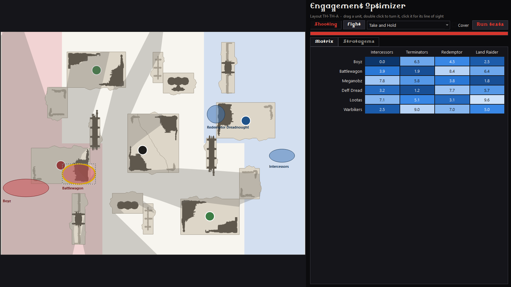

# Moving the app from tkinter to Qt: an evaluation

Branch `QT_migration`, 12 October 2026. Nothing of the app is changed on this branch: it adds this
document and a spike (`spikes/qt_spike.py`) that the figures below come from.

## Verdict

The migration is feasible and its technical risk is low. It is a rewrite of the front end only:
about 5,900 lines in 26 files under `command_center/ui/`, and no line of the back end.

It is worth doing if the Field Holomap and the charts are to keep growing, because that is where
tkinter has run out: every workaround listed below is in drawing, windows or threads. It is not
worth doing for the app as it stands today, which works, and whose workarounds are already paid for.

What it costs for certain: a download about twice as large (28 MB to 60 MB, measured), and a
front end with no tests behind it rewritten by hand and by eye.

Recommended: PySide6, in the stages of the plan below, with a decision point after the first tool.

## What was looked at

| | |
|---|---|
| Front end | `command_center/ui/`: 5,927 lines, 26 files import tkinter |
| Back end | `core`, `data`, `lists`, `deploy`, `analysis`: 5,561 lines, none imports tkinter |
| Outside `ui/` | `cli.py` starts the UI; `tests/test_translucent.py`, `tests/test_ui_registry.py`; `scripts/readme_screenshots.py` |
| Widgets | 124 `ttk.Label`, 113 `ttk.Frame`, 30 buttons, 16 canvases, 13 drop-downs, 12 top-levels, 10 `tk.Text`, 3 tables |
| Layout calls | 269 `pack`, 84 `grid`, 3 `place`, 81 `bind` |
| Canvas drawing | 82 calls drawing a shape or a text, in 7 files; most in `charts.py` and `map_view.py` |
| Dependencies | numpy only; PyInstaller for the release |

The separation is clean: the back end never reaches into the front end, and windows read their data
through `AppContext`. That is what makes this a front-end job.

## What tkinter costs today

Each of these is code the app carries because of the toolkit. Qt does it itself.

| In the app today | Where | With Qt |
|---|---|---|
| See-through fills: stipples, and on macOS shapes rasterised with numpy into a PNG written by hand | `ui/translucent.py` (81 lines) and its tests | A colour with an alpha value |
| Shapes drawn without anti-aliasing on Windows | every canvas | Anti-aliased |
| A board drawn again from nothing on every resize (`delete("all")`) | `map_view.py`, `charts.py` | A scene in inches that the view scales |
| Dragging: hit-testing, grab offset and clamping by hand; "current" item unreliable after a redraw; clicks 2 and 4 of a run handled apart | `map_view.py` | Movable items; one double-click event |
| The display font loaded through GDI or CoreText with ctypes | `theme.py` `load_fonts` | `QFontDatabase.addApplicationFont` |
| Dark title bar asked of DWM with ctypes, again each time a window gets a new frame | `theme.py`, 7 calls | One call for the application |
| Windows kept maximised by watching `<Configure>`; a title bar's height guessed, then measured | `screen.py` | Window states and frame geometry |
| DPI awareness set with ctypes, once for the process | `app.py` | Per-monitor, built in |
| Worker threads polled every 25 to 100 ms through a queue; `gc.collect()` so that no Tk object is finalised on the wrong thread | `auspex/window.py`, `optimizer/window.py`, `updater.py` | Signals delivered on the window's thread |
| Mouse wheel bound three ways (Windows, macOS, X11) in four places; scrolled frames made of a canvas | `charts.py`, `richtext.py`, `scoresheet.py`, `score_oracle.py` | Scroll areas |
| Tooltips as borderless top-levels; chart tooltips as canvas items kept inside the view by hand | `widgets.py`, `charts.py` | `setToolTip`, `QToolTip` |
| Wahapedia's HTML parsed by hand into tagged text | `richtext.py` (about 100 lines) | `QTextBrowser.setHtml` |
| Right click bound to buttons 2 and 3 for macOS | `charts.py`, `map_view.py` | One event |
| README screenshots copied from the screen with GDI: Windows only, windows in front, mouse left alone | `scripts/readme_screenshots.py` | `window.grab()`, in front or not, on any system |

Of the 14 commits that touch `ui/`, two exist wholly or partly for the toolkit and not for a
feature: the macOS fills (df8018e) and the windows filling the screen (68fe67d).

## The spike

`spikes/qt_spike.py`, 350 lines, on the app's real data and back end: layout TH-TH-A, the
line-of-sight code of `deploy/sight.py`, the palette of `theme.py`, the core stratagems' HTML.



What it showed, all run on this machine (Windows 11, Python 3.14.0, PySide6 6.12.0):

- PySide6 installs on Python 3.14 from a wheel, and a PyInstaller build of it starts and draws.
- The theme carries over as one style sheet of about 25 rules built from the same palette `C`.
  Caliban Angelus loads from `assets/fonts` with no platform code.
- The board is drawn once, in inches. Tokens are see-through, dragged by Qt and stopped at the
  edges by the app's own `clamp`. A turn is one call.
- Line of sight while dragging: 20 ms per redraw, of which 20 ms is `cast` itself. Qt's drawing does
  not show in the measure.
- A window can be pictured without a screen (`QT_QPA_PLATFORM=offscreen`), so windows can be opened
  in the tests on GitHub's runners. System fonts have to be pointed at (`QT_QPA_FONTDIR`), otherwise
  every text comes out in the display font.

Two things it tripped on, both small:

- A view does not keep its scene alive in Python: a reference must be held.
- `pip install` failed in a deeply nested folder (a path over 260 characters inside the package).
  The project's own path is short enough.

Not tried: macOS. Nothing here was run on it.

## What it costs

Measured on Windows, same PyInstaller options as `release.yml`:

| | tkinter (today) | Qt (the spike) |
|---|---|---|
| App folder | 63 MB | 143 MB |
| Zip to download | 27.6 MB | 59.7 MB |
| First window, from the source | 0.26 s | 0.53 s |
| Installed for development | nothing (ships with Python) | 215 MB (`PySide6-Essentials`) |

The Qt folder still holds Tcl/Tk (9 MB: the spike imports the palette from `theme.py`), a software
OpenGL library (20 MB) and Qt's translations (7 MB). Without them it would be near 105 MB. That is
an estimate, not a build.

The other costs:

- The app's own update downloads the zip: twice the size at every release.
- A second dependency. `requirements.txt` is numpy alone today.
- PySide6 is under the LGPL. A one-folder PyInstaller build, with Qt's libraries as separate
  files, is the usual way to comply; the licence text must ship with the app. PyQt6 is GPL or
  paid: not a candidate.
- The rewrite itself has no safety net. The 2,660 lines of tests cover the back end; of the front
  end, only the tool registry. What a window must do is in its code and its comments (label
  placement on the board, the editor closing on a wheel turn, and so on). The eleven README
  screenshots are the only reference to compare against.
- macOS: the `.app` grows by Qt's frameworks, unsigned as today. Untested. The release workflow's
  "start the built app" step would catch a build that does not come up.

## What stays as it is

- All of `core`, `data`, `lists`, `deploy`, `analysis`, `release.py`, `config.py`, `context.py`.
- The tool registry (`ui/registry.py`): one type hint to change.
- The release: still a PyInstaller folder holding an `.exe` and `_internal`, so the app's own update
  installs a Qt version over a tkinter one with no change.
- The Optimizer's worker processes (`multiprocessing.freeze_support()` in `main.py`).
- The colours, in `theme.C` and in each module's constants.

## Plan

tkinter and Qt cannot share a process, so there is no window-by-window mix inside one app. The
stages below are done on this branch, while `main` stays tkinter and can still be released. The
tkinter windows are left in place until the last stage.

| Stage | What | From (lines) | Notes |
|---|---|---|---|
| 1 | Shell: `app`, `toolwindow`, `screen`, `theme`, `widgets`, `updater`, `appupdate`, `launcher` | 972 | `screen.py` and the ctypes of `theme.py` mostly go |
| 2 | Disposition Cogitator, with `views/scoresheet` | 554 | Needs no list: the smallest whole tool |
| | **Decision point**: build both zips in the workflow, try the macOS one, compare with the screenshots | | Go on, or stop having spent a quarter of the work |
| 3 | `charts`, `richtext`, `views/rules` | 899 | Shared by the next two tools; `richtext` shrinks most |
| 4 | Armies Auspex | 833 | First worker thread |
| 5 | Engagement Optimizer | 1,173 | The largest; in-place editors in a table |
| 6 | Field Holomap, Score Oracle | 1,341 | `translucent.py` goes; the spike is its starting point |
| 7 | Remove tkinter, `release.yml`, both READMEs, `readme_screenshots.py` with `grab()`, window tests | | Drop OpenGL and the translations from the build |

To do alongside, from stage 1: a test that opens each window without a screen. It is what the
rewrite lacks most, and Qt is what makes it possible.

## Progress

Stages 1 to 6 are done, in `command_center/qt/`, next to the tkinter front end, which is untouched
but for its colours moving to `command_center/ui/palette.py` so that both read the same ones.

```bash
pip install -r requirements-qt.txt
python main_qt.py                 # or: python -m command_center qt
```

The Qt launcher offers every tool. What is left is stage 7: making it the app. `main.py`, `run_app.bat`
and the release still start the tkinter app.

What stages 1 and 2 showed:

- Nothing platform-specific is left in the shell but one call for the Windows taskbar. Fonts, dark
  title bars, DPI and window sizes are Qt's.
- One Qt application serves the update windows and the app. tkinter needed a root for each.
- The score sheet's texts wrap by themselves. The code that measured them and the layout that
  "chased" them are gone.
- The boards are drawn once and scaled by their view (`qt/views/board.py`). Stage 6 adds the units
  and overlays to it.
- Tick boxes and radio buttons had to be drawn by hand (`qt/widgets.py`): Qt's own are dark on dark
  with this palette.
- `tests/test_qt_windows.py` opens every Qt window without a screen, on the fixtures. It is skipped
  where PySide6 is not installed, as on the release workflow today.

Stage 3 is what the next two tools share: the charts (`qt/charts.py`), the rules text window
(`qt/richtext.py`) and the two rules windows (`qt/views/rules.py`). No tool shows them yet. What it showed:

- Wahapedia's HTML goes into one document nearly as it is, in place of the parser written for
  tkinter. Its tables are now tables (tkinter showed their cells in a line), and its lists are indented.
- It could not go in untouched. Wahapedia writes colours and sizes on its tags for a light page:
  they are taken out, with its images and links (`richtext.prepare`).
- Stratagem cards are a table of that same document. The pass that sized each card to its text,
  and the wheel passed on from the cards to the window, are gone. The search covers the cards and
  marks every match.
- The charts are painted as before, on a surface their scrolling area moves, and are no shorter. The
  rules text window is: 190 lines for 320.
  The charts' tooltips are Qt's.
- `tests/test_qt_views.py` clicks on the charts, searches the rules text and opens both rules
  windows, without a screen.

Stage 4 is the Armies Auspex (`qt/tools/auspex/`), the first tool on the charts' side of the app and
the first with work on another thread. What it showed:

- A simulation runs on a thread and comes back through a signal (`qt/worker.py`). The 25 ms poll and
  the two `gc.collect()` calls that kept tkinter's objects off that thread are gone.
- A result that is out of date is dropped as soon as something changes, not only when the next
  simulation starts: after a swap, tkinter could show the old sides' result for a moment.
- Tables are one widget (`widgets.Table`): the allocation order is dragged with Qt's own row
  dragging, in place of three mouse handlers.
- Drop-downs had to be given their arrow by hand (`widgets.Combo`), as tick boxes were.
- Waiting for a worker thread in a test must go through Qt's event loop: `QTest.qWait` keeps
  Python's lock, and the simulation took 6 s for 0.1 s.

Stage 5 is the Engagement Optimizer (`qt/tools/optimizer/`): the two unit panels, the run on worker
processes, and the results window with its five views. What it showed:

- The run reports its progress through a signal as tests finish, in place of a poll every 100 ms.
  The worker processes are the back end's, unchanged.
- A value is edited in its cell with a drop-down the table holds there: tkinter placed one over the
  cell by its pixel position and closed it when the table scrolled.
- A Qt widget has many methods, and an attribute of ours with the same name replaces one silently:
  a drop-down named `metric` broke every repaint of its window. Two names were changed; a method
  that hides tests is `hide_records`, since `hide` is the window's own.
- Splitters share their room by the sizes they are given, not by stretch factors, when what they
  hold has no size of its own (the charts).

Stage 6 is the Field Holomap and its Score Oracle (`qt/tools/holomap/`), the last tool. What it showed:

- Units are items Qt drags: the press, the grab offset and the move by hand are gone, and so is
  `ui/translucent.py`'s work, which has no counterpart here. A unit is see-through because its
  colour is.
- A board is drawn once per layout and its units put back on it; nothing is drawn again on a
  resize but the texts kept in pixels, which are placed again for the new scale.
- The boards and the info panel are still placed by `deploy.arrange`, in an area that has no
  layout of its own. Qt's layouts do not do "as large as possible".
- A mission card is a small HTML document, as the rules text is.
- On the score sheet, the wheel scrolls the sheet over a drop-down because the drop-down lets it
  pass: one line, in place of a binding on every drop-down.

The real app, built for Windows with the options of `release.yml` (`main_qt.py`, tkinter left out):

| | tkinter (today) | Qt, as built | Qt, without software OpenGL and translations |
|---|---|---|---|
| App folder | 63 MB | 134 MB | 107 MB |
| Zip to download | 27.6 MB | | 46.5 MB |

It starts and shows the launcher. The trimmed build was started too.

Left for the decision point: the macOS build, which needs the workflow. Not done here.

## Alternatives

- Stay on tkinter. Costs nothing. Right if no more drawing features are planned.
- Qt for the Holomap alone, as a second program. Two toolkits to ship and two looks: worse than either.
- A web front end. Audited apart: [web_migration.md](web_migration.md). More work than Qt for the same
  desktop app; the only way to an app with nothing to install.
