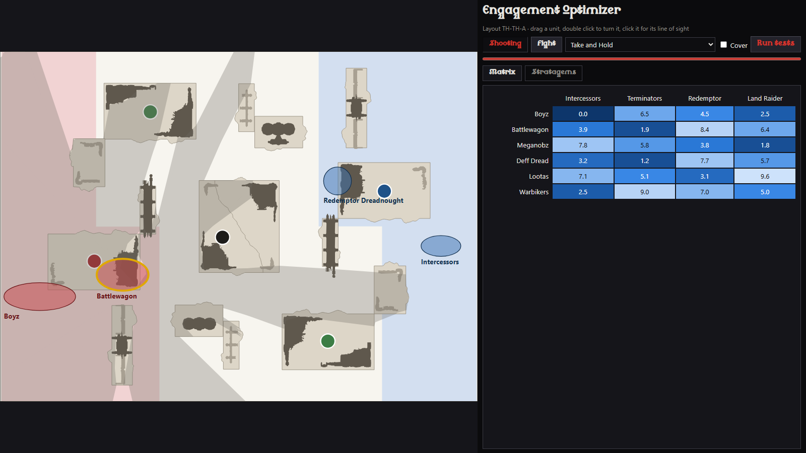

# A web front end: an evaluation

Branch `QT_migration`, 12 October 2026. The same audit as [qt_migration.md](qt_migration.md), for a
front end made of web pages. Nothing of the app is changed: this document, and a spike
(`spikes/web_spike/`) that the figures below come from. Qt was chosen; the spike was removed when the
migration ended, and is in the branch's history.

## Verdict

A web front end is feasible, and it is more work than Qt for the same desktop app. Qt replaces
5,900 lines of Python with Python. The web replaces them with HTML, CSS and JavaScript, and also
needs an interface between the two halves that does not exist today.

It gives one thing Qt cannot: reach. An app with nothing to install, on a tablet at the table.
That version is possible (the back end ran in a browser in the spike), but it is another product,
and it has an open question no code answers: who serves Wahapedia's data.

Recommended: Qt for a better desktop app. The web only if reaching players without an install is
the goal, and then decided on the data question first.

## Three ways to ship it

"A web front end" is three different things. All three were built or run in the spike.

| | A. Local server, the user's browser | B. Local server, a window of its own | C. No server: the back end in the page |
|---|---|---|---|
| What the user gets | An `.exe` that opens a browser tab | An `.exe` with its own window, as today | A web address |
| Python runs | On their machine | On their machine | In their browser (Pyodide) |
| New dependencies | None: standard library | pywebview (and pythonnet on Windows, pyobjc on macOS) | Pyodide, from a CDN; somewhere to host the pages |
| Lists, saved work, data | Files, as today | Files, as today | The browser's storage; files chosen by hand |
| Works on a tablet or phone | No | No | Yes |

B is the one that replaces the desktop app like for like. A is B without a window: a tab among
others, a server that does not know when the tab is closed, any browser the user happens to have.
C is the one that changes what the app is.

## What changes for all three

**A second language.** The back end imports nothing from the front end, which is what made Qt a
front-end job. Here the front end leaves Python altogether: the 5,927 lines of `command_center/ui/`
are rewritten as HTML, CSS and JavaScript.

**An interface that does not exist.** The windows use the back end's objects directly: 108 names
from 26 modules, among them live objects (`ArmyList`, `Unit`, `UnitPlan`, `Modifiers`, a
`ResultSet` over numpy arrays) that the windows read and change in place. Across a web page's
boundary each needs a JSON form in both directions, and someone must decide which side keeps the
state. This is new Python, with no counterpart in the Qt path. In the spike it is already
half of `server.py`, for one layout, four fixed units and a made-up matrix.

**Geometry written twice.** Dragging must answer at once, so the page needs the board's rules
itself: the spike rewrites `placement.extent` and `placement.clamp` in JavaScript. The real map
would also need the outlines, the label placement and the movement rings. Anything left in Python
costs a round trip: 31 ms for a line of sight, against 20 ms inside one process.

**What stays.** `core`, `data`, `lists`, `deploy`, `analysis` in A and B. The release as a
PyInstaller folder, and the app's own update with it. The colours.

## The spike

`spikes/web_spike/`: `server.py` (240 lines, standard library only), `index.html` (240 lines, no
framework, no build step), `pyodide.html` (60 lines). The same window as the Qt spike, on the same
layout, line-of-sight code and stratagem text.

What it showed, on this machine (Windows 11, Python 3.14.0, Chrome, pywebview 6.2.1, Pyodide 0.29.0):

- The theme is one style sheet on the same palette. The font loads with one `@font-face` rule.
- The board is an SVG in inches that the browser scales. See-through and anti-aliased as in Qt.
- One set of pointer events covers mouse, pen and finger.
- Progress of a long task is pushed by the server as it goes (server-sent events), in 10 lines.
- Wahapedia's HTML goes into the page as it is.
- A picture of the page was taken by a browser with no screen, as with Qt.
- pywebview installs and runs on Python 3.14, and a PyInstaller build of it starts.

And in the browser with no server (variant C):

- `deploy/sight.py` and the Wahapedia loader ran unchanged, on Python 3.13.
- `core/engine.py` did not: line 198 hands `np.repeat` 64-bit counts, which the browser's 32-bit
  Python refuses. The page narrows them to get a measure. There may be others: only one attack and
  the line of sight were run.
- Wahapedia sends no `Access-Control-Allow-Origin` header, so a page cannot download its CSVs. Rapid
  Ingress does send it.

Not tried: macOS (pywebview uses Safari's engine there, not Chrome's), a tablet, Firefox.

## What it costs

Measured on Windows, same PyInstaller options as `release.yml`. Qt's column is from the other audit.

| | tkinter (today) | Qt | Web A (browser) | Web B (window) |
|---|---|---|---|---|
| App folder | 63 MB | 143 MB | 53 MB | 57 MB |
| Zip to download | 27.6 MB | 59.7 MB | 24.5 MB | 27.3 MB |
| Line of sight while dragging | not measured | 20 ms | 31 ms | 31 ms |
| Languages in the front end | Python | Python | HTML, CSS, JavaScript | HTML, CSS, JavaScript |

The web builds are no larger than today's because they use a browser the system already has. That
has a price in memory: the packaged window (B) took 176 MB for Python plus 315 MB in six browser
processes, against 63 MB for today's launcher run from the source. The two are not the same window,
so read it as an order of size.

The window appeared 1.4 s after the packaged B was started; today's launcher, from the source, 1.2 s.

Variant C, the back end in the page:

| | In the app (Python 3.14) | In the browser (Pyodide) |
|---|---|---|
| Line of sight | 20 ms | 26 ms |
| One attack, 20,000 trials | 480 ms | 820 ms |
| Wahapedia's CSVs loaded | 125 ms | 254 ms |
| To download at the first visit | | 8.4 MB of Python and numpy, 1.5 MB of data, 0.1 MB of back end |
| Before anything can be computed | | 3.7 s at the first visit, 1.6 s after |

The other costs:

- **The Optimizer on one core (C).** It runs its tests on up to 8 processes today. A page has one
  thread, 1.7 times slower, unless each worker loads a Python of its own.
- **The data (C).** The page cannot fetch Wahapedia's export, so the data must come from a server
  of ours or be handed over by the user. The repository leaves it out on purpose (`.gitignore`:
  rules and stats are Games Workshop's). Publishing it is a decision, not a technical step.
- **Saved work (C).** Lists, test plans, army plans and Estimates go to the browser's storage: one
  browser on one device, gone when it is cleared.
- **Two engines (B).** WebView2 on Windows, WebKit on macOS: the same page checked on both. On
  Windows 10 the WebView2 runtime is usually there, not always.
- **A browser's habits (A).** Several tabs on one server, a tab closed with the server left
  running, a port to pick.
- **Tests.** The interface can be tested in Python with no screen, which is a gain. The pages need
  a browser driven from the tests: a tool the project does not have.
- **HTML from outside.** Putting Wahapedia's HTML into a page as it is is safe on the user's own
  machine. On a public address it must be cleaned first.

## Against Qt

| | Qt | Web B (window) | Web C (in the page) |
|---|---|---|---|
| Code to rewrite | 5,900 lines, Python to Python | 5,900 lines to another language, plus the interface | The same, plus storage and the data's source |
| Back end | Untouched | Untouched | To make run on 32 bits and on one thread |
| Download | Doubles | Unchanged | 10 MB once, no install |
| Drawing, transparency, fonts, scaling | Solved | Solved | Solved |
| Dragging against the back end | In one process | A round trip, or JavaScript copies | In one page |
| Tablet, phone, a link to share | No | No | Yes |
| Release and own update | As today | As today | Replaced by publishing pages |
| Untested here | macOS | macOS | Tablets, the Optimizer, most of the engine |

Both cure the same tkinter costs listed in the Qt audit. The web cures the download size as well.
It pays for that with the second language and the interface.

## If it were done

For B, in the order of the Qt plan, with one stage before it:

| Stage | What |
|---|---|
| 0 | The interface: JSON forms of lists, units, plans and results; where the state lives; its tests |
| 1 | Shell and launcher in a pywebview window; data and app updates |
| 2 | Disposition Cogitator |
| | **Decision point**: both zips built, the macOS one tried |
| 3 to 6 | Charts and rules text, Armies Auspex, Engagement Optimizer, Field Holomap |
| 7 | Remove tkinter; `release.yml`; READMEs; screenshots |

C is not a stage after B: its pages talk to Python in the page, not to a server, and its storage
is different. It would be chosen at stage 0. Before any of it: the data question, the engine made
to run on 32 bits, and the Optimizer measured on one thread.
